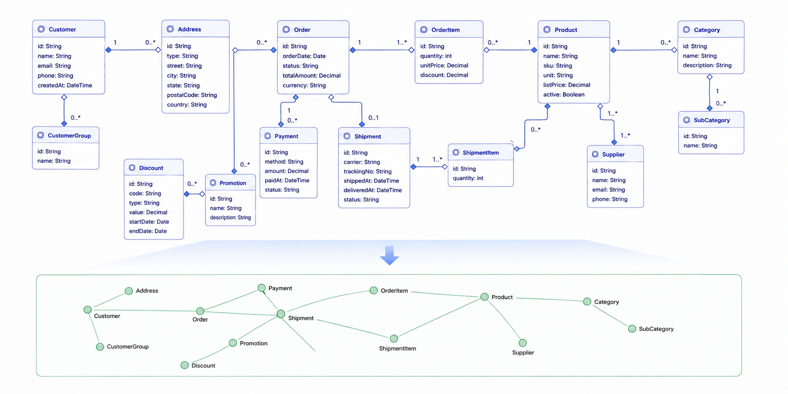

# Graph Subsystem — Usage Guide

A lightweight, **layered** property-graph layer on InterSystems IRIS. Edges live in the
`^GraphData` globals and are queryable through one engine, exposed three ways:
ObjectScript (`Graph.Tools`: single-hop, multi-hop, shortest path, BFS), SQL table-valued
functions (`Graph.SQL`) and a spec-first REST API (`Graph.REST`).

There are **two ways to populate the graph** — both feed the same globals and are queried by
the **same** engine:

- **Low-level data-layer graph** (the foundation) — write edges **directly** to the store with
  `Graph.Store.AddEdge` / `RemoveEdge`. Nodes are **generic node keys** and need not be backed by
  any class (virtual / synthetic node types), for example a knowledge graph of
  Knowledge / Entity nodes (§1).
- **Object-projected graph** — any persistent class extends `Graph.Object.Base` and turns
  selected reference properties into **graph edges** that are maintained automatically on every
  insert / update / delete, through **both the object layer and SQL** (§2–§4).



Every edge belongs to a **layer** — `Core` (read-only), industry **packs** (for example `pgx`)
and `User` — and reads return the union of the layers in the current view (§5).

**Contents**

- [Installation](#installation)
- [1. Concepts — the data-layer graph](#1-concepts--the-data-layer-graph-foundation)
- [2. The object-projected graph](#2-the-object-projected-graph)
- [3. Edge direction rules](#3-edge-direction-rules)
- [4. Automatic maintenance](#4-automatic-maintenance)
- [5. Layers](#5-layers)
- [6. Querying with `Graph.Tools`](#6-querying-with-graphtools)
- [7. Querying from SQL](#7-querying-from-sql)
- [8. Querying from REST (HTTP)](#8-querying-from-rest-http)
- [9. End-to-end example](#9-end-to-end-example)
- [10. Analysis, visualization and maintenance](#10-analysis-visualization-and-maintenance)
- [11. Limitations](#11-limitations)
- [12. Quick reference](#12-quick-reference)

---

## Installation

1. Import the classes of the `Graph` package into your namespace. The core is `Graph.Store`,
   `Graph.Layer`, `Graph.Tools`, `Graph.SQL`, `Graph.Object.*` and `Graph.REST.*`; `Graph.Analysis`
   and `Graph.UI.*` are optional. The demo classes (`Graph.Demo.*`) and the
   test and benchmark classes (`Graph.Test*`, `Graph.Benchmark`, `Graph.FanoutBench`) are not
   needed at run time.

   ```objectscript
   Do $SYSTEM.OBJ.LoadDir("/path/to/Graph", "ck", .err, 1)
   ```

2. Nothing else is required. The first write registers the `Core` (read-only) and `User`
   (read-write) layers and marks the namespace as layered.

3. To use REST, compile `Graph.REST.spec` (this generates `Graph.REST.disp`) and create a web
   application that dispatches `/api/graph` to `Graph.REST.disp` (see §8).

A namespace that already holds edge data in the older, non-layered layout (first subscript is the
node) must be converted once with `##class(Graph.Layer).Migrate("User")`. Until then reads and
writes fail with `LEGACY_GRAPH_LAYOUT`.

### Quick look with the Demo Container
For a quick look, simply build and start the demo container, which includes three demo use cases that run out of the box—no manual class imports, data preparation, or REST application setup required.

`git clone https://github.com/ISCQP/IRISGraph.git`
`cd <repository directory>/Graph`
`docker compose -f democontainer/docker-compose.yml up -d --build`
Once started, open the pages below in a browser.


####Demo 1: Logistics Risk Tracking (Logistics.UI.RiskDemo)
URL: http://localhost:52780/csp/testbed/Logistics.UI.RiskDemo.cls

Scenario: a geopolitical conflict breaks out in the Strait of Hormuz.

The conflict is modeled as a risk event. It affects the route segments passing through the strait, and a "120-hour delay" impact node is computed and propagated along the graph to the affected shipment SHP-1, purchase order PO-1001 and supplier Gulf Petrochem.

The page traces this with the single-hop, multi-hop and BFS functions of Graph.Tools:

Single hop: get the affected route segments;
Multi-hop: get the shipments, purchase orders and suppliers;
Five-step reverse multi-hop: trace back from a segment to find the shipments that actually pass through it. The data deliberately includes a control shipment, SHP-2, which detours around the Cape of Good Hope, and the reverse trace correctly excludes it;
BFS: starting from the risk, draw the entire impact subgraph.
The page also offers handling recommendations, and clicking "Trigger risk" replays the whole event.

Why it matters: the graph edges are maintained automatically by Graph.Object.Index when objects are saved, and the model contains not a single line of hand-written edge-building code. This is the most direct proof that "business data already contains knowledge": the risk, segments, shipments, purchase orders and suppliers are all ordinary business objects, and the impact-chain analysis simply walks along their references.

####Demo 2: EMR Contact Tracing (EMR.UI.ContactTrace)
URL: http://localhost:52780/csp/testbed/EMR.UI.ContactTrace.cls

This is a "graph vs. SQL" comparison demo.

It uses synthetic presence records for 2,000 people to derive person-to-person contacts, about 52,000 edges. The question is: starting from the index case, along contact chains with increasing time, who could be reached within k generations?

Graph side: a temporal BFS that expands only along edges whose contact time is not earlier than the time the previous person was infected;
SQL side: k self-joins on the contact table, with a time-monotonicity constraint added at each hop, and intermediate results that grow with the k-th power of the degree.
The page times both sides side by side for different values of k and checks that the results agree. On local data with k=3, the graph and pure SQL both return 1,428 people (this result is from a different dataset; the data in the new image is regenerated, so the headcount will differ slightly). A plain BFS that ignores time returns a larger upper bound.

Why it matters: It illustrates the performance advantages of graph-based approaches over pure SQL for specific analytical use cases. The third subscript of an edge directly stores the contact time, so this example also shows how to use "numeric IDs + writing edges directly with Graph.Store", which is the low-level data-layer graph, whereas the previous demo is an object projection graph. Both ways of building a graph use the same query engine.

####Demo 3: Genome Knowledge Graph (GenomeCircos, ClinicalResearch.Demo.GenomeCircos)
URL: http://localhost:52780/csp/testbed/ClinicalResearch.Demo.GenomeCircos.cls

A "genome → diagnosis → medication" knowledge graph for a sample patient, P001. It is hand-curated synthetic data: real gene symbols and chromosomal loci, star-allele or rsID variants, pathways, diseases, phenotypes, drugs, and pharmacogenomic relationships organized according to CPIC guidelines.

The data is stored in the same ^GraphData, with node types for patient, variant, gene, pathway, disease, phenotype and drug. The page fetches the data once and switches between three views on the front end using a Circos circular plot:

Genome coordinates: arcs by chromosome, with cross-chromosome fusions such as BCR-ABL1 and EML4-ALK drawn as highlighted chords;
Knowledge reasoning: arcs by node type, with all relations drawn as chords, showing the multi-hop reasoning "patient → variant → gene → pathway/disease → phenotype → drug";
Medication safety: arcs by gene, with gene-to-drug edges colored by metabolism, target, transport, HLA risk, contraindication and resistance.
Why it matters: this is the "traditional knowledge" side of the story. The knowledge graph is stored as a data-layer graph and shares the same graph engine with business data through the layer mechanism.

---

## 1. Concepts — the data-layer graph (foundation)

At its core the graph is just typed, directed **edges between node keys**, stored in globals.
This layer knows nothing about objects — you can build a complete graph over synthetic / virtual
nodes that have **no `%Persistent` class** at all.

### Node key

A node is identified by an opaque **node key** — **any application-defined identifier**. A
convenient convention is `$ListBuild(id, type)`, but the key can be any value:

```objectscript
Set kb  = $ListBuild("KB-001", "Knowledge")
Set ent = $ListBuild("FHIR",   "Entity")
```

(The object-projected graph in §2 uses a *specific* form of node key — the OID
`$ListBuild(Id, ClassName)` — but the store itself treats every key generically.)

> **ID typing matters.** `$ListBuild(10, cls)` and `$ListBuild("10", cls)` are different keys.
> Object-projected graphs always store string ids, so write `'10'` in SQL and `"10"` in
> ObjectScript. A directly written graph may use numeric ids; use the same type you wrote.

### Edge

A directed, typed link between two nodes:

```
(SourceNode) --[Relation]--> (TargetNode)
```

### Globals

| Global           | Shape                                            | Purpose                                                      |
| ---------------- | ------------------------------------------------ | ------------------------------------------------------------ |
| `^GraphData.OUT` | `(Layer, Source, Target, Relation) = ""`         | The edges — used for **querying** (forward). The first subscript is the **layer**; the rest are **node keys**. |
| `^GraphData.IN`  | `(Layer, Target, Source, Relation) = ""`         | **In-edge index** — a pure mirror of `OUT` (per layer) keyed by target; makes **reverse** queries O(in-degree). Maintained automatically by `Graph.Store`; consumed by `Graph.Tools` (§10). |
| `^GraphData.OWN` | `(Layer, Owner, Source, Relation, Target) = ""`  | Edges owned by each persistent object (object graph only), used by the functional index for insert/update/delete. |
| `^Graph.Layer`   | `(Layer) = $lb(tier, rank, mode, enabled, desc)` | Layer registry (§5).                                         |

You never write these globals by hand; `Graph.Store` maintains them for you.

### Writing edges directly

When the nodes are synthetic / virtual, write edges through the core data-layer writer
`Graph.Store`:

```objectscript
Do ##class(Graph.Store).AddEdge(kb, "MENTIONS", ent)             // OUT + IN maintained, default write layer
Do ##class(Graph.Store).AddEdge(kb, "MENTIONS", ent, 1, "pgx")   // explicit layer
// ... later ...
Do ##class(Graph.Store).RemoveEdge(kb, "MENTIONS", ent)          // removes OUT + IN
```

- `AddEdge(Source, Relation, Target[, pGenOut[, pLayer]])` writes the forward edge
  `^GraphData.OUT(Layer, Source, Target, Relation)` **and** the in-edge mirror
  `^GraphData.IN(Layer, Target, Source, Relation)`; `RemoveEdge` removes both.
- These nodes have **no** `^GraphData.OWN` ownership rows and **no** functional index — you
  add/remove edges yourself (for example a full `Rebuild()` / `Clear()`).
- Node descriptions/attributes (which `^GraphData.OUT` cannot hold) go in your own global, keyed by
  node key.
- Querying works the same as for any graph data: `Graph.Tools` / `Graph.SQL` / REST all read
  `^GraphData.OUT` / `^GraphData.IN`, whichever way the edges were written.

---

## 2. The object-projected graph

The object-projected graph builds the **same** edges automatically from your **persistent
classes**: mark reference properties as graph properties and the edges are maintained on every
insert / update / delete, through both the object layer and SQL.

### Node (OID)

Here every saved row of a graph-enabled class is a **node**, identified by its **OID** — the
object graph's specific form of the generic node key from §1:

```
NodeOID = $ListBuild(Id, ClassName)
```

e.g. `$lb("2","Test.SalesOrder")`.

### Additional globals

On top of `^GraphData.OUT` / `^GraphData.IN` (§1), the object-projected graph uses two more
globals, **specific to the object graph**:

| Global           | Shape                                                    | Purpose                                                      |
| ---------------- | -------------------------------------------------------- | ------------------------------------------------------------ |
| `^GraphData.Dic` | `(SourceType, Relation, TargetType, Inverse) = PropName` | Graph dictionary — built at **compile time**. Not layered.   |
| `^GraphData.OWN` | `(Layer, OwnerOID, SourceOID, Relation, TargetOID) = ""` | Which node **owns** each edge — used for maintenance (fast delete/rebuild). |

### Defining a graph class

Extend `Graph.Object.Base` (in addition to `%Persistent`) and mark reference properties with the
graph parameters.

```objectscript
Class Logistics.Business.Product Extends (%Persistent, Graph.Object.Base)
{

Property SKU As %String;
Property Name As %String;

/// classified_as : Product -> HSCode
Property HSCode As Logistics.Policy.HSCode(Direction = "FROM", Relation = "classified_as");

/// supplies : Supplier -> Product  (many Products belong to one Supplier)
Relationship Supplier As Logistics.Business.Supplier(Direction = "FROM", Relation = "supplies") [ Cardinality = one, Inverse = Products ];

}
```

That is all. On compile, a projection (`Graph.Object.IndexProjection`) automatically injects the
functional indexes that maintain the edges. **No manual index declaration is needed.**

### Graph property parameters

Defined in `Graph.Object.PropertyParameters`:

| Parameter   | Values        | Meaning                                                      |
| ----------- | ------------- | ------------------------------------------------------------ |
| `Direction` | `FROM` / `TO` | **Marks the property as a graph property** and is recorded in the dictionary. A property is a graph property **only if `Direction` is set**. |
| `Relation`  | string        | The edge type, e.g. `"supplies"`, `"Customer-SalesOrder"`. Defaults to the property name. |
| `Inverse`   | `1` / `0`     | Force the edge to be recorded in the reverse direction (see §3). Default `0`. |
| `GraphUse`  | `1` / `0`     | Only relevant in `Auto` mode: set to `0` to explicitly **exclude** a property that would otherwise be auto-included. |

Supported property kinds (the referenced target class must be a **non-`%Library.SerialObject`**
type — i.e. a persistent reference; embedded / serial objects are not graph properties):

- **Scalar reference** — `Property X As SomeClass(Direction=...)`
- **Relationship** — `Relationship X As SomeClass(Direction=...) [ Cardinality = one/many, Inverse = ... ]`
- **Collection** — `Property X As list of SomeClass(Direction=...)` or `array of`

> Note: parent-child relationships (`Cardinality = parent`) are currently **not supported** due to
> a known issue.

### Class parameter `GRAPHLAYER`

`Parameter GRAPHLAYER = "";` chooses the layer a class writes its edges to. Empty means the default
write layer, `User`. It is resolved at run time, so changing it needs **no recompile** of the
model. Writing to a read-only, disabled or unregistered layer fails the save.

### Auto mode (`Auto` class parameter)

Set the class parameter `Auto = 1` on a graph class and the projection will **automatically**
include qualifying reference properties in the graph at compile time, without hand-writing
`Direction` on each one:

```objectscript
Class Logistics.Business.Product Extends (%Persistent, Graph.Object.Base)
{
Parameter Auto = 1;

Property Name As %String;                          // literal → ignored
Property HSCode As Logistics.Policy.HSCode;        // persistent reference → auto-included
Property Supplier As Logistics.Business.Supplier;  // persistent reference → auto-included
}
```

- When `Auto` is undefined it **defaults to `0`** (off).
- With `Auto = 1`, the projection **physically injects `Direction = "TO"`,
  `Relation = <PropertyName>`, `Inverse = 0`** onto qualifying property definitions at compile
  time (becoming the single source of truth for the class). Qualification rules:
  - **Included**: scalar reference / relationship / list / array collection whose target is a persistent class;
  - **Excluded**: literal datatypes, `%SerialObject` embedded objects, the "one" side of a one-to-many (`Cardinality = one` / relationship one side), and the parent side of a parent-child relationship (`children`).
- **User settings are never overwritten**: if a property already declares `Direction`, or already
  has a manually set `Relation` / `Inverse`, those values are **preserved** — `Auto` only fills in
  the missing parameters.
- Set `GraphUse = 0` to **exclude** a property that would otherwise be auto-included.

---

## 3. Edge direction rules

The stored edge normally goes **from this object to the referenced object**:

```
(thisNode) --[Relation]--> (referencedNode)
```

The edge is **reversed** (referenced → this) when the property is the *many / child* endpoint,
i.e. any of:

- `Cardinality = one`
- `Cardinality = parent` *(currently unsupported — see §2)*
- `Inverse = 1`

This keeps edges pointing consistently from the **"one"** side to the **"many"** side. Examples:

| Declaration                          | Stored edge                                                  |
| ------------------------------------ | ------------------------------------------------------------ |
| `Product.HSCode` (scalar)            | `Product --classified_as--> HSCode`                          |
| `Product.Supplier` (Cardinality one) | `Supplier --supplies--> Product`                             |
| `RouteSegment.PassesThrough` (list)  | `RouteSegment --passes_through--> Location` (one edge per element) |
| `Impact.Cause` (Inverse 1)           | `RiskEvent --causes--> Impact`                               |

The edge is always **owned by the object that declares the property**, so deleting/updating that
object cleans up exactly its edges.

---

## 4. Automatic maintenance

Once a class is graph-enabled, edges are maintained on **every** data-change path — you do not
call anything:

| Operation | Object layer                | SQL layer                           |
| --------- | --------------------------- | ----------------------------------- |
| Insert    | `obj.%Save()` (new)         | `INSERT INTO ...`                   |
| Update    | `obj.%Save()` (existing)    | `UPDATE ...` (incl. multi-row)      |
| Delete    | `%DeleteId()` / `%Delete()` | `DELETE FROM ...` (incl. multi-row) |

Behavior:

- **Insert** — reads current property values and adds one edge per non-null reference (one per collection element).
- **Update** — removes all edges owned by the row (in every layer), then rebuilds from current values (safe when the foreign key changes; no dangling edges).
- **Delete** — removes all edges owned by the row (no need to read old values).
- **Null reference** — produces no edge.

### Rebuilding edges for existing data

The injected indexes support `BUILD INDEX`, so you can (re)populate edges for a class whose data
already exists:

```objectscript
Do ##class(%SYSTEM.OBJ).Compile("Logistics.Business.Product")   // ensures index exists and the dictionary is written
Do ##class(Logistics.Business.Product).%BuildIndices()          // rebuilds all indices incl. GraphIndex*
```

`PurgeIndex` (called during rebuild) clears the class's existing edges first, so rebuilds are
idempotent.

---

## 5. Layers

Every edge lives in exactly one **layer** — the first subscript of `OUT`, `IN` and `OWN`.
Layers are registered in `^Graph.Layer` and managed by `Graph.Layer`.

| Tier       | Typical layer                  | Default mode |
| ---------- | ------------------------------ | ------------ |
| `core`     | `Core`                         | read-only    |
| `industry` | a knowledge pack such as `pgx` | read-write   |
| `user`     | `User`                         | read-write   |
| `scenario` | for example a what-if layer    | read-write   |

### Read view

Reads return the **union** of the layers in the *view*; the same edge present in several layers
is returned once. The default view is `Core,User` plus installed packs. Override it:

```objectscript
Do ##class(Graph.Tools).SingleHop(node, "", 0, .r, "User")        // per call (trailing pLayers)
Do ##class(Graph.Layer).SetView("Core,pgx,User")                  // per process
Do ##class(Graph.Layer).SetDefaultView("Core,pgx,User")           // system default
```

SQL functions take a trailing `layers` argument (§7) and REST bodies a `layers` field (§8).

### Write layer

A write goes to exactly one layer. Precedence:
explicit `pLayer` > class parameter `GRAPHLAYER` > `Graph.Layer.SetWriteLayer()` > default write
layer (`User`). `Core` rejects writes unless the process calls `Graph.Layer.AllowWrite("Core")`.

### Managing layers

```objectscript
Do ##class(Graph.Layer).InstallPack("pgx", "Pharmacogenomic knowledge", 50)  // idempotent; added to the default view before User
Do ##class(Graph.Layer).Define("scenarioA", "scenario", 60, "rw", "What-if edges")
Do ##class(Graph.Layer).Enable("scenarioA", 0)      // a disabled layer is neither read nor written
Write ##class(Graph.Layer).List().%ToJSON()          // name, tier, rank, mode, enabled, desc (by rank)
Write ##class(Graph.Layer).Digest("pgx").%ToJSON()   // {"OUT":[count,bytes],"IN":[..],"OWN":[..]}
Do ##class(Graph.Layer).Drop("scenarioA")            // removes the whole layer: OUT, IN and OWN
```

A layer can also be mapped to its own database with subscript-level global mappings, for example a
read-only `Core` database.

### Behavior to know

- Layers do not override one another: reads are a plain union, with no tombstones or shadowing.
- `Migrate("User")` converts an older non-layered namespace in place and verifies it with a digest;
  on failure it restores the original data.
- Reads cost one scan unit per layer and direction; keep the view to the layers you need on hot
  paths.

---

## 6. Querying with `Graph.Tools`

All query methods return a `%DynamicArray` of hop objects shaped as:

```json
{ "OID": "<sourceOID>", "Relation": "<rel>", "TargetOID": "<targetOID>" }
```

where each OID is a `$ListBuild(Id, ClassName)` value. Every method takes an optional trailing
`pLayers` (§5).

| Method                                                       | Purpose                                                      |
| ------------------------------------------------------------ | ------------------------------------------------------------ |
| `SingleHop(node, relation, inverse, .result [, pLayers])`    | Neighbours; `relation` empty = all, comma-separated = several; `inverse = 1` = incoming |
| `MultiHop(start, relList, .result [, pLayers])`              | Follow an ordered relation path; each step is `{"Relation":..,"Inverse":0/1}` |
| `ShortestPath(start, end, .result, .stats [, degreeAware [, pLayers]])` | Undirected bidirectional BFS                                 |
| `BFS(start, maxDepth, .result [, pLayers])`                  | Undirected breadth-first traversal                           |
| `BFSDirected(start, maxDepth, .result, direction, relation [, pLayers])` | BFS with a direction (0 out, 1 in, 2 both) and a relation filter |
| `BFSNodes(start, maxDepth, .nodes, direction, relation [, pLayers])` | Reachable nodes with minimum depth                           |
| `BFSParallel(start, maxDepth, .result, workers, … [, pLayers])` | Multi-process, level-synchronous BFS for very large graphs   |

### Single hop

```objectscript
Set node = $ListBuild("1", "Logistics.Business.Supplier")

// Outgoing edges from node (all relations)
Do ##class(Graph.Tools).SingleHop(node, "", 0, .result)

// Only specific relations (comma-separated)
Do ##class(Graph.Tools).SingleHop(node, "supplies,supplier_in_country", 0, .result)

// Incoming edges (who points AT node) -> set pInverse = 1
Do ##class(Graph.Tools).SingleHop(node, "", 1, .result)
```

### Multi hop (ordered relation path)

```objectscript
Set risk = $ListBuild("10", "Logistics.Risk.RiskEvent")
Set rels = [
  {"Relation":"causes","Inverse":0},
  {"Relation":"impact_affects_shipment","Inverse":0}
]
Do ##class(Graph.Tools).MultiHop(risk, rels, .result)
```

### Shortest path (undirected BFS over edges)

```objectscript
Do ##class(Graph.Tools).ShortestPath(startNode, endNode, .path)
// path = ordered array of hop steps, each with Relation / Inverse / OID / TargetOID
```

### Breadth-first traversal with depth limit

```objectscript
Do ##class(Graph.Tools).BFS(startNode, 3, .result)   // up to 3 hops
```

### `*WithNO` variants (query by business number)

`SingleHopWithNO`, `MultiHopWithNO`, `ShortestPathWithNO`, `BFSWithNO` and `BFSParallelWithNO` (in
`Graph.Object.Tools`, a subclass of `Graph.Tools` for object-backed graph data) accept a **class
name + business number** instead of an OID, plus the same trailing `pLayers`. They resolve the
node via a class method your class must implement:

```objectscript
ClassMethod GetOIDByNO(pNO As %String) As %String
{
    // return $ListBuild(id, $classname()) for the row whose business number = pNO, else ""
}
```

Example:

```objectscript
Do ##class(Graph.Object.Tools).SingleHopWithNO("Logistics.Business.Product", "SKU-001", "supplies", 1, .result)
```

---

## 7. Querying from SQL

The same traversals are exposed as **custom SQL table-valued functions** in `Graph.SQL`. They
read the graph globals directly — **they are not backed by any SQL table** — and return standard
result sets usable in the `FROM` clause, including joins back to your base tables.

Nodes are passed as two arguments `(Class, Id)` (equivalent to the internal `$ListBuild(Id, Class)`
OID) and returned as separate `Class` / `Id` columns.

| Function             | Signature                                                    | Columns                                                      |
| -------------------- | ------------------------------------------------------------ | ------------------------------------------------------------ |
| `Graph.SingleHop`    | `(class, id, relation, inverse[, layers])`                   | `SourceClass, SourceId, Relation, TargetClass, TargetId`     |
| `Graph.MultiHop`     | `(class, id, relPath[, layers])`                             | same 5 columns (final hop of each path)                      |
| `Graph.BFS`          | `(class, id, maxDepth[, layers])`                            | same 5 columns                                               |
| `Graph.BFSParallel`  | `(class, id, maxDepth[, workers[, layers]])`                 | same 5 columns                                               |
| `Graph.BFSNodes`     | `(class, id, maxDepth[, direction[, relation[, resultClass[, layers]]]])` | `NodeClass, NodeId, Depth`                                   |
| `Graph.ShortestPath` | `(startClass, startId, endClass, endId[, layers])`           | `StepNo, Relation, Inverse, SourceClass, SourceId, TargetClass, TargetId` |

- `layers` (optional): comma-separated layer names; empty = the current view.
- `relation` filter: empty = all; comma-separated = multiple.
- `inverse`: `0` = outgoing edges (node is source), `1` = incoming edges (node is target).
- `relPath` (MultiHop): ordered `"Relation:Inverse,Relation:Inverse,..."`, e.g. `'causes:0,impact_affects_shipment:0'`.
- `direction` (BFSNodes): `0` outgoing (default), `1` incoming, `2` both. Use `2` to match `BFS`
  reachability. `resultClass` filters the output only; traversal may pass through other classes.
- Edges are returned in their **stored** direction. For an incoming hop, the node you started from
  is on the target side and the node you reached is in `SourceId`.
- `class` is the class name stored in the graph, which is not necessarily the SQL table name. Join
  on both `TargetClass` and `TargetId`.
- Only `SingleHop` streams. The others finish the traversal before the first row is fetched, so
  an outer `WHERE` or `TOP` does not prune the traversal. Row order is not guaranteed without
  `ORDER BY`. There is no snapshot isolation.
- Do not wrap the functions in `TABLE(...)`; call them directly in `FROM`.
- The node-key type rule applies: object graphs take `'10'`, graphs written with numeric ids take `10`.

The examples use the logistics risk-tracing demo (`Logistics.Risk.RiskEvent` id `10`).

```sql
-- 1. outgoing edges from a node; join the result back to a base table
SELECT s.ID, s.Name
FROM Graph.SingleHop('Logistics.Risk.RiskEvent','10','affects_segment',0) h
JOIN Logistics_Route.RouteSegment s ON s.ID = h.TargetId;

-- 2. who points AT a node (incoming): the supplier of product 1
SELECT su.Name
FROM Graph.SingleHop('Logistics.Business.Product','1','supplies',1) h
JOIN Logistics_Business.Supplier su ON su.ID = h.SourceId;      -- node reached is the source

-- 3. multi-hop path ending in a base table: risk -> impact -> shipment
SELECT sh.ID, sh.ShipmentNo
FROM Graph.MultiHop('Logistics.Risk.RiskEvent','10','causes:0,impact_affects_shipment:0') h
JOIN Logistics_Transport.Shipment sh ON sh.ID = h.TargetId;

-- 4. reverse multi-hop: shipments in transit through a segment
--    segment <- route <- voyage <- vessel <- container <- shipment
SELECT sh.ID, sh.ShipmentNo
FROM Graph.MultiHop('Logistics.Route.RouteSegment','1',
     'route_contains_segment:1,uses:1,assigned_to:1,loaded_on:1,contains:1') h
JOIN Logistics_Transport.Shipment sh ON sh.ID = h.SourceId;

-- 5. breadth-first traversal, aggregated by node class
SELECT TargetClass, COUNT(*) AS Edges
FROM Graph.BFS('Logistics.Risk.RiskEvent','10',2)
GROUP BY TargetClass ORDER BY Edges DESC;

-- 6. reachable entities with their depth, filtered to one class and joined
SELECT sh.ShipmentNo, n.Depth
FROM Graph.BFSNodes('Logistics.Risk.RiskEvent','10',4,0,'','Logistics.Transport.Shipment') n
JOIN Logistics_Transport.Shipment sh ON n.NodeId = sh.ID
ORDER BY n.Depth;

-- 7. shortest path between two nodes (one row per step)
SELECT StepNo, Relation, Inverse, SourceClass, SourceId, TargetClass, TargetId
FROM Graph.ShortestPath('Logistics.Risk.RiskEvent','10','Logistics.Transport.Shipment','1')
ORDER BY StepNo;
-- 1 | causes                  | RiskEvent#10 -> Impact#10
-- 2 | impact_affects_shipment | Impact#10    -> Shipment#1
```

### A base-table row and its graph neighbours in one statement

```sql
SELECT r.ID, r.Name, r.Type, r.Severity, r.Location->Name AS Loc,
       s.ID AS SegId, s.Name AS SegName
FROM Logistics_Risk.RiskEvent r
JOIN Graph.SingleHop('Logistics.Risk.RiskEvent',
                     CAST(r.ID AS VARCHAR(20)),      -- graph ids are strings
                     'affects_segment', 0) h ON 1=1
JOIN Logistics_Route.RouteSegment s ON s.ID = h.TargetId
WHERE r.ID = 10;
```

`r.ID` is an integer column, so it must be cast to a string before it is used as a node id. Use
`LEFT JOIN` to keep rows that have no neighbours.

### Filter a base table by graph reachability (semi-join)

```sql
SELECT p.ID, p.SKU
FROM Logistics_Business.Product p
WHERE p.ID IN (
  SELECT TargetId
  FROM Graph.SingleHop('Logistics.Business.Supplier','1','supplies',0)
);
```

### Choosing layers in SQL

```sql
-- only the pgx knowledge layer
SELECT SourceId, Relation, TargetClass, TargetId
FROM Graph.SingleHop('Entity','Warfarin','',0,'pgx');

-- cross-layer: a knowledge node (pgx layer) bridged to a business-table row
SELECT d.ID, d.Name
FROM Graph.SingleHop('Entity','Warfarin','resolves_to',0,'Core,pgx,User') h
JOIN ClinicalResearch.Drug d
  ON h.TargetClass = 'ClinicalResearch.Drug' AND d.ID = h.TargetId;
```

The same hop restricted to `'User'` returns no rows, because those edges live in `pgx`.

### A directly written graph with numeric ids: contact tracing

The contact-tracing demo writes person-to-person contact edges directly, with numeric ids. The
third subscript of each edge is the contact time `Ct`, returned in the `Relation` column.

```sql
-- direct contacts of person 1 (graph); Relation carries the contact time
SELECT Relation AS Ct, TargetId
FROM Graph.SingleHop('CTBench.Person', 1, '', 0)
ORDER BY 1;

-- the same facts from the relational contact table (identical edge set)
SELECT PersonB, Ct, LocId, Tier
FROM EMR_Test.CTContact WHERE PersonA = 1 ORDER BY Ct;

-- people within 2 hops, joined back to their presence records
SELECT TOP 3 b.TargetId, p.LocId, p.TStart
FROM Graph.BFS('CTBench.Person', 1, 2) b
JOIN EMR_Test.CTPresence p ON p.PersonId = b.TargetId
WHERE b.TargetClass = 'CTBench.Person'
ORDER BY b.TargetId;
```

"Who can be reached within k generations along time-respecting contacts" is a recursive
question. In plain SQL it takes k self-joins of the contact table, each with a monotonic `Ct`
condition (3 generations from person 1):

```sql
SELECT COUNT(DISTINCT P) FROM (
  SELECT c1.PersonB AS P FROM EMR_Test.CTContact c1
   WHERE c1.PersonA = 1 AND c1.Ct >= 0
  UNION
  SELECT c2.PersonB FROM EMR_Test.CTContact c1
   JOIN EMR_Test.CTContact c2 ON c2.PersonA = c1.PersonB AND c2.Ct >= c1.Ct
   WHERE c1.PersonA = 1 AND c1.Ct >= 0
  UNION
  SELECT c3.PersonB FROM EMR_Test.CTContact c1
   JOIN EMR_Test.CTContact c2 ON c2.PersonA = c1.PersonB AND c2.Ct >= c1.Ct
   JOIN EMR_Test.CTContact c3 ON c3.PersonA = c2.PersonB AND c3.Ct >= c2.Ct
   WHERE c1.PersonA = 1 AND c1.Ct >= 0
) d WHERE P <> 1;
```

On the demo data this returns 1428, the same count as the graph traversal
(`EMR.Test.ContactTrace.GraphReach`). A plain `Graph.BFS` ignores time and returns the larger,
non-time-respecting reachable set.

### Parameterized call from ObjectScript

```objectscript
Set stmt = ##class(%SQL.Statement).%New()
Set sc = stmt.%Prepare("SELECT NodeClass, NodeId, Depth FROM Graph.BFSNodes(?,?,?,?)")
If $SYSTEM.Status.IsError(sc) { Do $SYSTEM.Status.DisplayError(sc) Quit }
Set rs = stmt.%Execute("Logistics.Risk.RiskEvent", "10", 3, 0)
While rs.%Next() { Write rs.NodeClass, " ", rs.NodeId, " ", rs.Depth, ! }
```

---

## 8. Querying from REST (HTTP)

The traversals are also exposed as a **spec-first REST API** (`%REST`):

- `Graph.REST.spec` — OpenAPI 2.0 definition (the contract).
- `Graph.REST.impl` — business logic wrapping `Graph.Tools`.
- `Graph.REST.disp` — dispatch class, **auto-generated** when the spec compiles.
- Web application `/api/graph` → `Graph.REST.disp`.

All endpoints are `POST`, accept and return JSON. Nodes are expressed as
`{ "class": ..., "id": ... }` (or `{ "class": ..., "no": ... }` to resolve by business number via
`<class>.GetOIDByNO`). The internal OID is never exposed.

| Endpoint                       | Body                                                 | Result                                                       |
| ------------------------------ | ---------------------------------------------------- | ------------------------------------------------------------ |
| `POST /api/graph/singlehop`    | `{ node, relation?, inverse?, layers? }`             | `{ edges:[{source,relation,target}], count }`                |
| `POST /api/graph/multihop`     | `{ node, relations:[{relation,inverse?}], layers? }` | `{ endpoints:[…], count }`                                   |
| `POST /api/graph/shortestpath` | `{ start, end, layers? }`                            | `{ found, length, path:[{step,relation,inverse,source,target}] }` |
| `POST /api/graph/bfs`          | `{ node, maxDepth?, layers? }`                       | `{ maxDepth, edges:[…], count }`                             |
| `POST /api/graph/addedge`      | `{ source, relation, target, layer? }`               | `{ ok, source, relation, target }`                           |
| `POST /api/graph/removeedge`   | `{ source, relation, target, layer? }`               | `{ ok, source, relation, target }`                           |

- `layers` (queries): comma-separated layer names; empty = the current view.
- `layer` (`addedge` / `removeedge`): the layer to write; empty = the default write layer (`User`).
- `relation`: empty = all; comma-separated = multiple.
- `inverse`: `0` = outgoing (node is source), `1` = incoming (node is target).
- Missing / invalid `node` returns `400` with `{ "error": ... }`.
- `addedge` / `removeedge` **write** low-level edges via `Graph.Store` (§1) — they maintain
  `^GraphData.OUT` / `^GraphData.IN` for the data-layer graph. Here `source` / `target` are
  **generic node keys** `{ class, id }` (mapped to `$ListBuild(id, class)`); the `no`
  business-number resolution does **not** apply. Use them only for the data-layer graph —
  object-projected edges are maintained automatically (§4).

```bash
# segments affected by a risk event
curl -X POST http://<host>/api/graph/singlehop \
  -H 'Content-Type: application/json' \
  -d '{"node":{"class":"Logistics.Risk.RiskEvent","id":"10"},"relation":"affects_segment","inverse":0}'

# who points AT a product (incoming)
curl -X POST http://<host>/api/graph/singlehop \
  -H 'Content-Type: application/json' \
  -d '{"node":{"class":"Logistics.Business.Product","id":"1"},"relation":"supplies","inverse":1}'

# multi-hop path: risk -> impact -> shipment
curl -X POST http://<host>/api/graph/multihop \
  -H 'Content-Type: application/json' \
  -d '{"node":{"class":"Logistics.Risk.RiskEvent","id":"10"},"relations":[{"relation":"causes","inverse":0},{"relation":"impact_affects_shipment","inverse":0}]}'

# breadth-first traversal, up to 2 hops
curl -X POST http://<host>/api/graph/bfs \
  -H 'Content-Type: application/json' \
  -d '{"node":{"class":"Logistics.Risk.RiskEvent","id":"10"},"maxDepth":2}'

# shortest path
curl -X POST http://<host>/api/graph/shortestpath \
  -H 'Content-Type: application/json' \
  -d '{"start":{"class":"Logistics.Risk.RiskEvent","id":"10"},"end":{"class":"Logistics.Transport.Shipment","id":"1"}}'

# add a data-layer edge  KB-001 --MENTIONS--> FHIR into the pgx layer
curl -X POST http://<host>/api/graph/addedge \
  -H 'Content-Type: application/json' \
  -d '{"source":{"class":"Knowledge","id":"KB-001"},"relation":"MENTIONS","target":{"class":"Entity","id":"FHIR"},"layer":"pgx"}'

# remove that edge
curl -X POST http://<host>/api/graph/removeedge \
  -H 'Content-Type: application/json' \
  -d '{"source":{"class":"Knowledge","id":"KB-001"},"relation":"MENTIONS","target":{"class":"Entity","id":"FHIR"},"layer":"pgx"}'
```

> Deploy: compiling `Graph.REST.spec` generates `Graph.REST.disp`; then create a web application
> mapping `/api/graph` to `Graph.REST.disp` in your namespace (for example via
> `%REST.API.CreateApplication("Graph.REST")` or the Management Portal).

---

## 9. End-to-end example

```objectscript
// --- create data (edges are maintained automatically, in the User layer) ---
Set sup = ##class(Logistics.Business.Supplier).%New()
Set sup.Name = "ACME"
Do sup.%Save()

Set prod = ##class(Logistics.Business.Product).%New()
Set prod.SKU = "SKU-001"
Set prod.Supplier = sup          // -> edge  Supplier --supplies--> Product
Do prod.%Save()

// --- query: which products does this supplier supply? ---
Set supNode = $ListBuild(sup.%Id(), "Logistics.Business.Supplier")
Do ##class(Graph.Tools).SingleHop(supNode, "supplies", 0, .result)
Write result.%ToJSON()

// --- query: who supplies this product? (incoming edge) ---
Set prodNode = $ListBuild(prod.%Id(), "Logistics.Business.Product")
Do ##class(Graph.Tools).SingleHop(prodNode, "supplies", 1, .result)
Write result.%ToJSON()
```

The same questions in SQL, joined to the business tables:

```sql
-- products of supplier 1
SELECT p.ID, p.SKU, p.Name
FROM Graph.SingleHop('Logistics.Business.Supplier','1','supplies',0) h
JOIN Logistics_Business.Product p ON p.ID = h.TargetId;

-- supplier of product 1
SELECT su.Name
FROM Graph.SingleHop('Logistics.Business.Product','1','supplies',1) h
JOIN Logistics_Business.Supplier su ON su.ID = h.SourceId;
```

---

---

## 10. Analysis, visualization and maintenance

### `Graph.Analysis`

`Graph.Analysis.Analyze(.report [, minMB [, sampleSize [, maxNodes [, maxScans [, layers]]]]])`
measures the storage of the graph globals and, only when it exceeds the threshold (64 MB by
default), samples nodes to estimate degree statistics and recommend traversal settings. Small
graphs return `decision = small-graph` and no recommendations. `Analyze` never changes settings;
accepting a suggestion is an explicit call to `AcceptSuggestion(report, .applied)`. Run it while
the graph is stable and `OUT` / `IN` agree.

### `Graph.UI.Network`

A reusable vis-network component for CSP pages:

```objectscript
Do ##class(Graph.UI.Network).Head()                                   // inside <head>
Write "<style>", ##class(Graph.UI.Network).CSS(), "</style>"
Set opts = ""
Do ##class(Graph.UI.Network).Widget("net", graphJSON, .opts)          // renders into <div id='net'>
```

`graphJSON` is `{"nodes":[{id,label,group,title}],"edges":[{from,to,label}]}`.
`BuildFromGlobal(prefix, provider, layers)` can build it from the graph globals.

### Verifying and digesting

```objectscript
Set miss = ##class(Graph.Store).Verify(.out, .in)   // mirror check
Write ##class(Graph.Layer).Digest("User").%ToJSON()  // compare before / after a bulk change or migration
```

---

## 11. Limitations

- Parent-child relationships (`Cardinality = parent`) are not projected in this version, will be added in future version.
- Numeric and string node ids are different keys; use one type consistently per graph.
- SQL traversals other than `SingleHop` complete before returning rows; an outer `WHERE` / `TOP`
  does not prune the traversal, and no row order is implied without `ORDER BY`.
- Reads are not snapshot-isolated.
- Relation-filtered hops on very high-fan-out nodes are slower than unfiltered traversal.
- Layers do not override one another: reads are a plain union.

---

## 12. Quick reference

- **Enable (object-projected graph):** `Extends (%Persistent, Graph.Object.Base)` + set `Direction` & `Relation` on reference properties; or set the class parameter `Auto = 1` to auto-include persistent reference properties. `Parameter GRAPHLAYER` picks the layer.
- **Data-layer graph (no objects):** write edges directly with `##class(Graph.Store).AddEdge(src, rel, tgt[, pGenOut[, pLayer]])` / `RemoveEdge(...)` (node key = `$ListBuild(id, type)`); same query APIs.
- **Layers:** `Core` (read-only) / industry packs (e.g. `pgx`) / `User` (default write layer). Reads = union over the view (default `Core,User` + installed packs; override with trailing `pLayers`, REST `layers`, or `Graph.Layer.SetView`); writes go to one layer (`pLayer` > `GRAPHLAYER` > `SetWriteLayer` > `User`). Manage with `Graph.Layer.Define / InstallPack / Enable / Drop / List / Migrate / Digest`.
- **Reverse an edge:** `Inverse = 1`, or use a `Relationship` with `Cardinality = one` / `parent`.
- **Maintenance:** automatic on object & SQL insert/update/delete; nothing to call.
- **Rebuild existing data:** `%BuildIndices()`.
- **Query:** `Graph.Tools` → `SingleHop` / `MultiHop` / `ShortestPath` / `BFS` / `BFSDirected` / `BFSNodes` / `BFSParallel` (works on any graph data, accelerated by the `^GraphData.IN` in-edge index). For object-backed data, `Graph.Object.Tools` adds the `*WithNO` variants (query by business number). Use `##class(Graph.Store).BuildIN()` to rebuild the index if it drifts.
- **Query from SQL:** `Graph.SQL` table-valued functions → `Graph.SingleHop` / `Graph.MultiHop` / `Graph.BFS` / `Graph.BFSParallel` / `Graph.BFSNodes` / `Graph.ShortestPath` (usable in `FROM`, joinable, not table-backed; ids are strings for object graphs).
- **Query from REST:** spec-first `%REST` API at `/api/graph` (`Graph.REST.spec` + `Graph.REST.impl`). Query → `POST /singlehop` / `/multihop` / `/shortestpath` / `/bfs`; write data-layer edges → `POST /addedge` / `/removeedge`.
- **Storage:** `^GraphData.OUT(Layer, …)` (edges), `^GraphData.IN(Layer, …)` (in-edge index), `^GraphData.OWN(Layer, …)` (ownership), `^GraphData.Dic` (dictionary, not layered); layer registry in `^Graph.Layer`.
